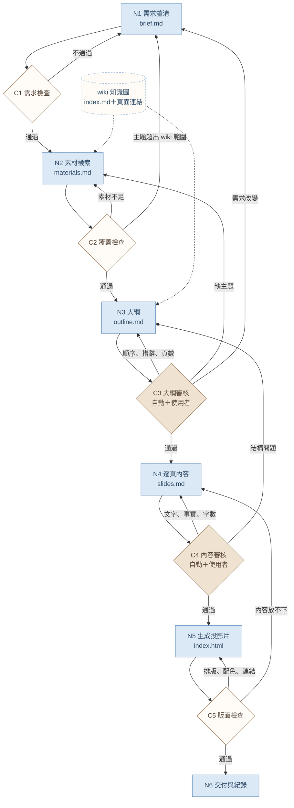

# 簡報產生 Graph（slide-graph）

用 wiki 內容產生 HTML 教學簡報的流程。流程設計成一個 **graph**：

- **節點（nodes）**：6 個工作階段 N1–N6，加上 5 個檢查點 C1–C5。
- **狀態（state）**：每個階段寫出一個中間檔，下一個節點只讀這些檔案。
- **連線（edges）**：檢查通過就往下走；不通過時，依失敗原因退回指定的節點。
- **迴圈（loops）**：每個「節點 → 檢查 → 退回」都是一個小迴圈，修到通過為止。

另外，wiki 本身的連結構成一張**知識圖**，用在 N2（挑素材）和 N3（排順序）。

> 本檔是規格。Claude 產生簡報時必須照本檔執行，並把每次檢查的結果寫進執行紀錄 `run-log.md`。

---

## 1. 流程圖



圖例：淺藍＝工作節點；米白＝自動檢查；淺咖啡＝自動檢查後還要**使用者確認**；虛線＝知識圖提供資料。

**升級規則（防止無限迴圈）**：同一個檢查點**連續失敗 2 次**，就停下來把問題交給使用者決定，不再自行重做。

---

## 2. 狀態：中間檔

每次執行建立一個資料夾 `outputs/runs/<YYYY-MM-DD>-<主題>/`：

| 檔案 | 由誰寫 | 內容 |
|---|---|---|
| `brief.md` | N1 | 需求：主題、對象、目的、頁數範圍、風格、資料範圍 |
| `materials.md` | N2 | 素材清單：用到的 wiki 頁、對應的講義投影片、缺口 |
| `outline.md` | N3 | 大綱：每頁標題、一句主旨、版型、出處 |
| `slides.md` | N4 | 逐頁內容：每頁實際文字、數字、補充標記 |
| `index.html` | N5 | 成品簡報 |
| `run-log.md` | 每個檢查點 | 檢查紀錄：第幾次、通過或退回、失敗項目、修正方式、退回到哪個節點 |

規則：

- 中間檔都是 Markdown，用固定的標題格式（見 §5），方便自動檢查，也方便使用者在 Obsidian 裡直接修改。
- 退回重做時，**直接修改**原中間檔，並在 `run-log.md` 記下改了什麼；不另存多個版本。
- 使用者在中間檔上的手動修改，視為該節點的新輸出，下一個檢查點照樣檢查。

---

## 3. 節點

### N1 需求釐清 → `brief.md`
- 向使用者確認：主題、對象、目的、頁數範圍、風格、資料範圍（哪幾份講義）、語氣。
- 風格沒有特別指定時，沿用預設：手帳風、淺藍＋淺咖啡、波點與星星（見 [layouts.md](layouts.md)）。
- **風格在這裡就要確定**，避免做完才改（這是從第一份簡報學到的教訓）。

### N2 素材檢索 → `materials.md`（使用知識圖）
1. 讀 `wiki/index.md`，找出和每個主題直接相關的頁面，作為**起點頁**。
2. 沿起點頁裡的連結往外找**一層**，把相關的概念、比較、易錯點列為**候選頁**。
3. 每頁記下：路徑、一句重點、對應的講義投影片編號、建議用在哪個主題。
4. 找不到頁面的主題列為**缺口**，不自行補寫。

### N3 大綱 → `outline.md`（使用知識圖）
- 每頁寫：標題、一句主旨、版型（必須是版型庫裡的版型）、出處（wiki 頁＋投影片編號）。
- **排序規則**：一頁會用到的概念，要在同一頁或前面的頁面先介紹過。依據是知識圖，分兩步：
  1. **找候選**：第 X 頁的出處頁連到某個概念頁，而那個概念頁是後面某一頁的主角 → 列為「往後連結」。
  2. **確認是否真的用到**：只有當該概念**出現在第 X 頁的主旨或預定內容**裡，才算違規；違規時調整順序，或在第 X 頁加一句說明，並寫進大綱的「先後說明」表。
  - （v2，2026-11-22 第一次執行後修訂：wiki 的連結代表「相關」，不代表「必須先學」；只看第 1 步會產生大量誤報。）
  - （v3，第 3 次執行起）**寫大綱之前就先跑 C3-4 的候選清單**，把真正用到的往後連結直接寫進「先後說明」表，不等 C3 退回。


### N4 逐頁內容 → `slides.md`
- 依大綱寫出每頁實際要放的文字、數字、圖示建議、出處。
- 所有數字、年份、專有名詞都要能在 wiki 頁裡找到；wiki 沒有的就不寫。
- 非課程內容標「補充」；wiki 標註過的疑點（例如沙賓法案年份）照樣標註。
- 每個欄位的字數不能超過版型的上限。
- （v3，第 3 次執行起）**名詞照 wiki 原文寫**：不自行縮寫、不把句子壓縮成新名詞、不改英文大小寫；寫完先逐一搜尋名詞清單再交給 C4（C4-5 連續失敗後前移到這裡）。

### N5 生成投影片 → `index.html`
- 以樣板 `outputs/slides/investing-101-top10.html` 的 CSS 與 JS 為基礎，依 `slides.md` 逐頁套用版型。
- 另外加上 v2 版面規則：`.body` 內容垂直置中；V-cards 卡片內文 22px、行高 1.8（第一次執行時 C5-7 發現卡片頁下半部空白而新增）。
- v3 版面規則（第 2 章執行時新增）：沒有比例長條的 V-two 頁，便利貼列加上 `roomy` 樣式（內文 23px）；出處列右側的投影片編號不換行。
- v4 版面規則（第 5 章執行時新增）：V-equation 用 `.flow.eq`，泡泡內距、emoji（52px）與標題（26px）放大，結論大字置中；第一次用時算式泡泡太扁，C5-7 只有 58%。
- **以最近一次執行的 `index.html` 為基礎**複製 CSS 與 JS，這樣前幾次的版面修正會自動帶到下一章。
- 不新增版型庫以外的顏色或版型；如果真的需要，先回 N3 請使用者同意。

### N6 交付與紀錄
- 確認 `run-log.md` 完整，填好最上方的統計表（每個檢查點跑了幾次）。
- 在 `wiki/log.md` 新增一筆 `query` 紀錄。
- 更新專案根目錄的**章節首頁** `index.html`：把該章卡片改成可點擊、連到這次的 `index.html`，標上頁數；簡報導覽列要有「回首頁」連結。

---

## 4. 檢查點

每個檢查項目都有編號，`run-log.md` 用編號記錄。標「人」的項目需要使用者回覆。

### C1 需求檢查（自動）
| 編號 | 檢查內容 |
|---|---|
| C1-1 | brief 的必填欄位都有值：主題、對象、目的、頁數範圍、風格、資料範圍 |
| C1-2 | 資料範圍內的講義都已匯入（`wiki/sources/` 有對應頁） |
| C1-3 | 風格已指定，或明確寫「沿用預設」 |

不通過 → **N1**（問使用者補齊）。

### C2 覆蓋檢查（自動）
| 編號 | 檢查內容 |
|---|---|
| C2-1 | brief 的每個主題至少對到 1 個 wiki 頁 |
| C2-2 | 素材清單裡每個路徑都存在 |
| C2-3 | 每個素材都標了講義投影片編號 |
| C2-4 | 缺口已列出，且沒有被偷偷補寫 |

素材不足 → **N2**；主題需要尚未匯入的講義 → **N1**（縮小範圍，或先匯入講義）。

### C3 大綱審核（自動＋人）
| 編號 | 檢查內容 |
|---|---|
| C3-1 | 頁數在 brief 的範圍內 |
| C3-2 | 每頁都有標題、一句主旨、版型、出處 |
| C3-3 | 沒有兩頁的主旨重複 |
| C3-4 | 排序符合知識圖：頁面**實際用到**的概念都已先介紹，或在「先後說明」表中處理（判斷方式見 N3 排序規則，v2） |
| C3-5 | brief 的每個主題都有對應的頁 |
| C3-6 | 每頁版型都在版型庫裡 |
| C3-7（人） | 使用者確認方向、順序、取捨 |

順序、措辭、頁數問題 → **N3**；缺主題 → **N2**；使用者改變需求 → **N1**。

### C4 內容審核（自動＋人）
| 編號 | 檢查內容 |
|---|---|
| C4-1 | 事實核對：每個數字、年份、專有名詞，都逐一比對 wiki 頁，並列出比對表 |
| C4-2 | 每頁都有出處（wiki 頁＋投影片編號） |
| C4-3 | 非課程內容都標了「補充」 |
| C4-4 | 每個欄位的字數不超過版型上限 |
| C4-5 | 用語、符號、中英對照和 wiki 一致 |
| C4-6 | wiki 標註過的疑點照樣標註 |
| C4-7（人） | 使用者確認每頁的文字與語氣 |

文字、事實、字數問題 → **N4**；需要增刪頁或換順序 → **N3**。
如果發現是 **wiki 本身寫錯**，先記錄在 `run-log.md`，請使用者決定是否修正 wiki（屬於 Lint 流程）。

### C5 版面檢查（自動）
| 編號 | 檢查內容 |
|---|---|
| C5-1 | 每頁內容都沒有超出版面（在瀏覽器裡逐頁檢查） |
| C5-2 | 頁數、標題順序和 `slides.md` 一致 |
| C5-3 | 只用主視覺色票（版型庫列出的顏色） |
| C5-4 | 所有出處連結都指到存在的檔案 |
| C5-5 | 字型載入失敗時能正常顯示；沒有顯示不出來的 emoji 或字元 |
| C5-6 | 逐頁截圖，目視確認沒有重疊或歪掉 |
| C5-7 | 版面平衡：每頁內容高度至少占內容區 60%，且垂直置中、不全部擠在上半頁（用程式量測）（v2，第一次執行後新增） |
| C5-8 | 出處列只占一行（用程式量測高度）（v3，第 2 章執行後新增） |

排版、配色、連結問題 → **N5**；內容放不下、需要刪字 → **N4**。

---

## 5. 中間檔格式

### brief.md
```markdown
# Brief
- 主題：
- 對象：
- 目的：
- 頁數範圍：
- 風格：
- 資料範圍：
- 語氣：
- 備註：
```

### materials.md
```markdown
# Materials
## 主題：<主題名>
- [頁面標題](../../wiki/...) — 一句重點（L01 投影片 n）
## 缺口
- <沒有 wiki 頁的主題>
```

### outline.md
```markdown
# Outline
| # | 標題 | 一句主旨 | 版型 | 出處 |
|---|---|---|---|---|
```

### slides.md
```markdown
# Slides
## 01｜<標題>
- 版型：<版型代號>
- 副標：
- 內容：（依版型的欄位逐項寫）
- 補充：（若有，標明非課程資料）
- 出處：
```

### run-log.md
```markdown
# Run log：<主題>

## 統計
| 檢查點 | 執行次數 | 退回次數 | 主要失敗項目 |
|---|---|---|---|

## 紀錄
### [C3 大綱審核] 第 1 次｜退回
- 失敗項目：C3-4 ……
- 修正：……
- 退回到：N3
```

---

## 6. 本設計從哪裡學來

第一份簡報（「10 個重點」）是在建立這個 graph 之前手動做的，過程中遇到的問題直接變成了檢查項目：

| 實際發生的問題 | 對應的設計 |
|---|---|
| 視覺風格做完才被退回兩次（太正式 → 太繽紛） | N1 必須先確定風格；C1-3、C5-3 |
| 寫錯 CSS 屬性，數字貼紙沒有旋轉 | C5-6 逐頁截圖目視 |
| 用了顯示不出來的骨牌 emoji | C5-5 |
| 講義的沙賓法案年份有疑點 | C4-6 疑點照樣標註 |
| 擔心字太多擠爆版面 | 版型庫字數上限＋C4-4、C5-1 |

## 7. 修訂紀錄（從實際執行學到的）

| 版本 | 哪次執行後 | 發現的問題 | 修改 |
|---|---|---|---|
| v2 | 第 1 次（top10） | C3-4 候選 19 筆中 16 筆是誤報 | N3 排序規則改成「真的用到才算違規」 |
| v2 | 第 1 次（top10） | 卡片頁下半部空白 | 新增 C5-7 版面平衡；N5 卡片置中、字放大 |
| v3 | 第 2 次（ch02） | 雙便利貼頁太空、出處列換行 | 新增 C5-8；N5 加 `roomy`；N5 改成沿用上一次的 CSS |
| v3 | 第 3 次（ch03） | C3-4、C4-5 都是「做完才被退回」 | C3-4 前移到 N3 寫大綱前；用語規則前移到 N4 |
| v4 | 第 5 次（ch05） | 第一次用 V-equation，算式頁內容高度 58% | N5 新增 `.flow.eq` 尺寸規則 |
